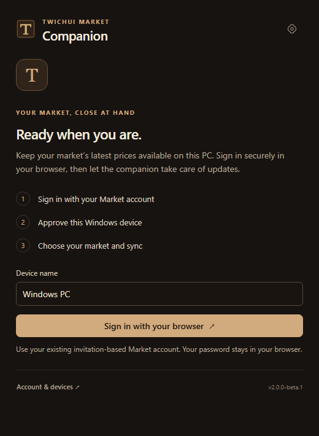
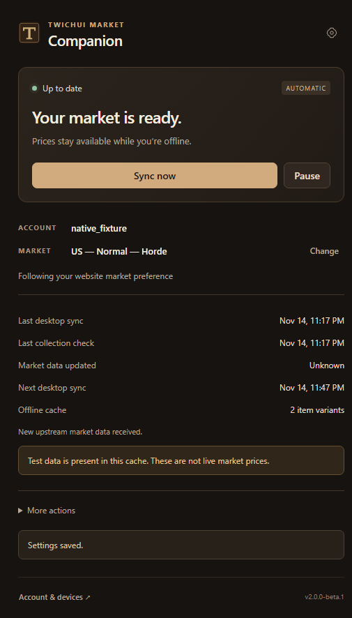
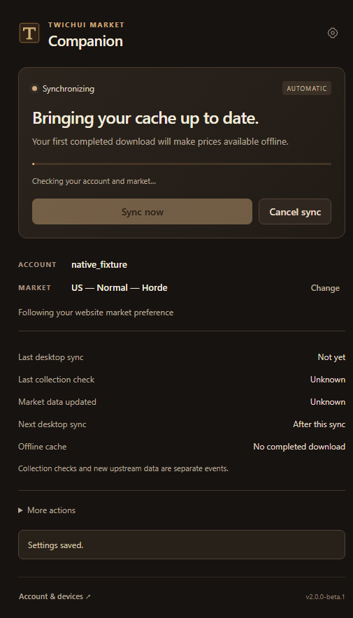
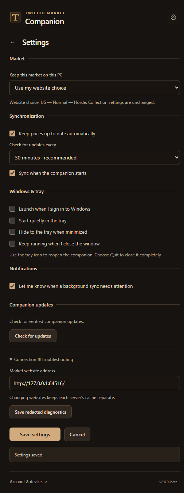
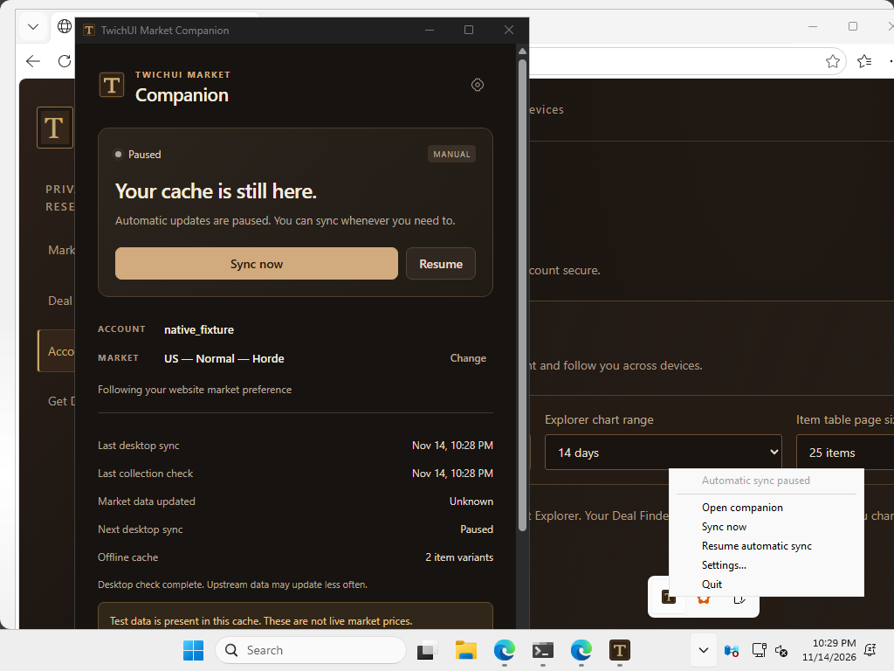
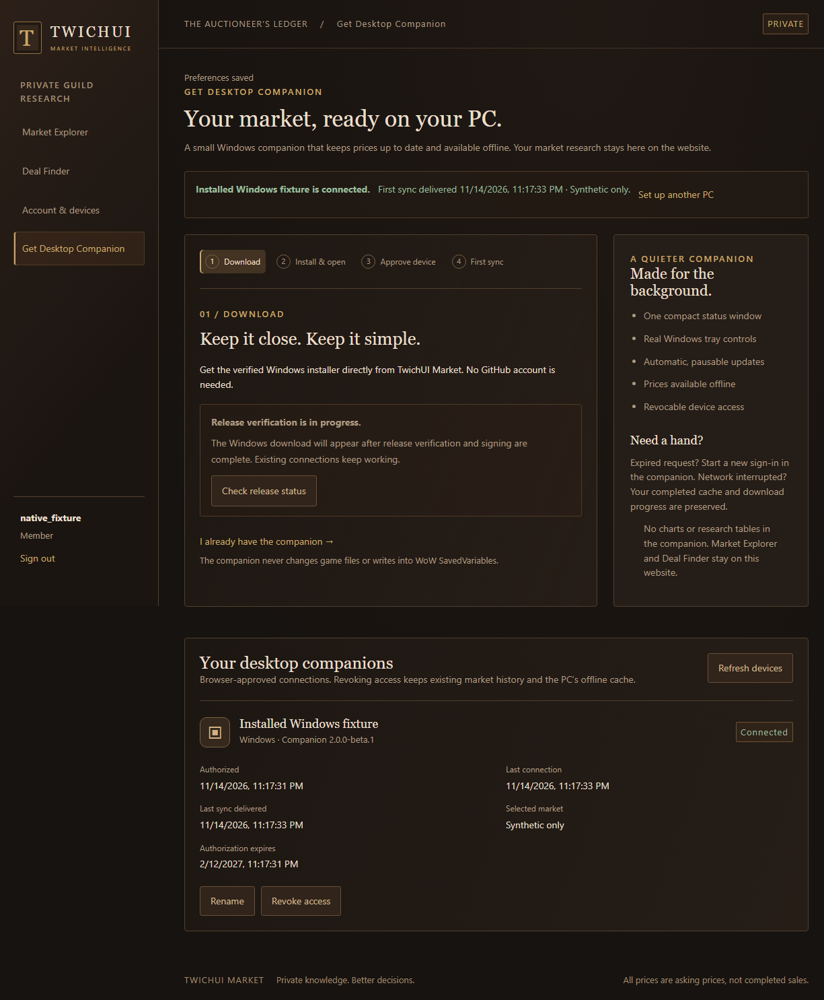
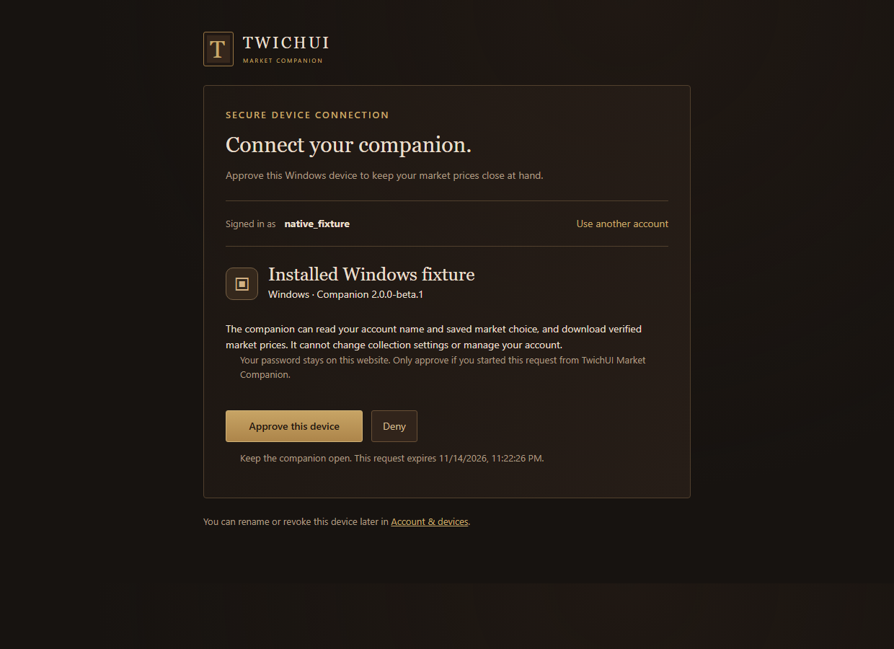
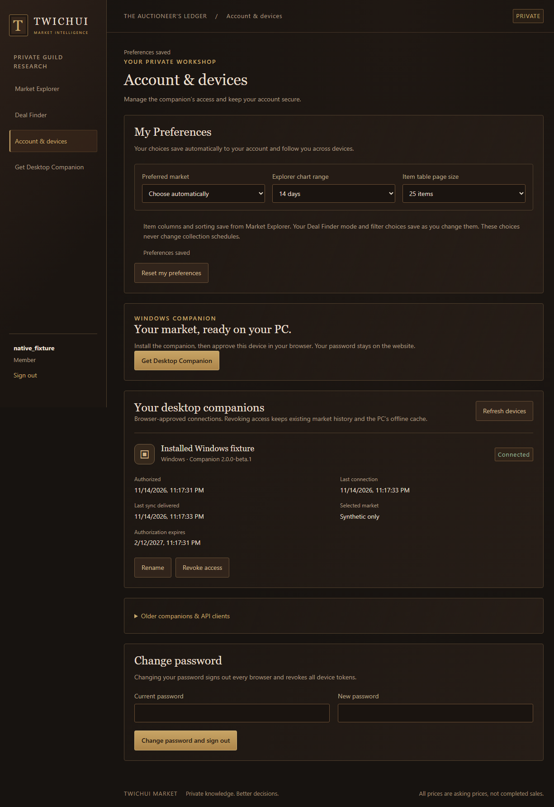

# Companion v2 actual screenshot review

**Owner visual approval recorded.** The owner explicitly answered “Approve these designs” after reviewing this packet. [Approval evidence](evidence/companion-v2-owner-visual-approval.json) binds that approval to the exact screenshot hashes and source. Tray actions and signed-installer acceptance remain unverified. These are actual installed Windows WebView2/Edge captures from verified source **e55807c58c4cf68560729471019b88cc518fb5b0 / Windows43652127596**, plus the actual OS notification-area capture from **2d66026 / Windows43647891422**. No generated mockups or replacement tray imagery. All data/accounts shown are synthetic; no production market-price or owner-account claim is made. CI timestamps reflect its Windows locale/timezone. Full-page captures include the app's scrollable content; they do not imply a taller default native window.

The [provenance manifest](evidence/companion-v2-screenshots/provenance.json) records each original PNG SHA-256, exact source, run and downloaded/verified artifact hash. The eight files are preserved unchanged in the repository so owner review does not depend on expiring artifacts. [Functional acceptance](companion-v2-acceptance.md) and [manual PC checklist](companion-v2-windows-manual-acceptance.md) remain distinct. A local [eight-image gallery](evidence/companion-v2-screenshots/index.html) opens without a server or network.

Inspected readability, spacing, contrast/palette, label consistency, visible actions, scrollable content, native-menu identity and separation of desktop checks from collection/upstream timestamps. The desktop remains a compact synchronization utility; research stays on the website. Earlier narrow release-notice layout and scrolled-header captures were corrected before this packet. No major visual defect was observed in these captures, and owner approval is now recorded separately from testing. Multi-monitor/DPI and real PC tray action acceptance remain in the manual checklist.

## 1. Welcome / sign in

First launch stays visible, asks for a device name and opens normal browser sign-in; no password or manual token field.

## 2. Connected dashboard

Connection, account, friendly market choice, sync/check/upstream times, next sync and offline cache stay separate. Unknown upstream time remains unknown. The fixture warning is intentionally visible.

## 3. Synchronization progress

Actual installed initial synchronization with cancel and honest no-completed-cache state. The screenshot covers full scrollable content.

## 4. Settings

Actual scrollable settings with market, scheduling, reversible Windows/tray preferences, notification/update controls and advanced troubleshooting. This is a test's current settings state, not a claim that every displayed checkbox is a first-run default. The loopback address is the isolated fixture endpoint, not a production URL.

## 5. Real Windows notification menu

Actual `NotifyItemIcon` / `SystemTray.NormalButton` in the hidden-icons area. This proves menu rendering; **tray actions remain UNVERIFIED** because the runner exposes its popup as Pane with zero MenuItem descendants. No extra automatic retry is required. See the [precise evidence](evidence/companion-v2-tray-runner.json).

## 6. Website download/setup wizard

Server-confirmed connected-device status is distinct from the selected guide step. The download honestly remains unavailable while release signing/acceptance is incomplete. A clicked download never asserts installation.

## 7. Browser authorization approval

Actual Edge browser account consent identifying the Windows device, limited access and expiry, with explicit approval/denial and account switching.

## 8. Connected devices

Actual Account & Devices with preferences, owned native metadata, expiry/activity and rename/revoke. Existing advanced legacy clients remain separate. Revocation text correctly preserves offline-cache/history context.

The recorded owner approval covers the new desktop and website companion surfaces at the source above. It does not accept tray actions, provision signing credentials, authorize expense or prove signed update/public deployment behavior. Those outcomes retain their own evidence gates.
