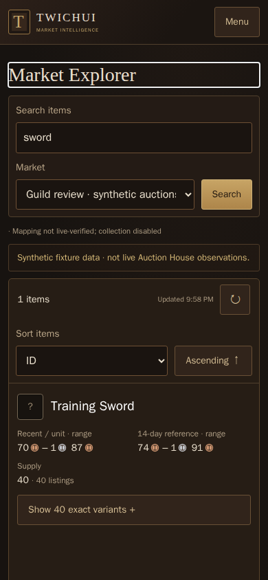
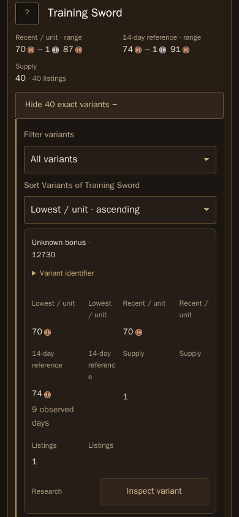
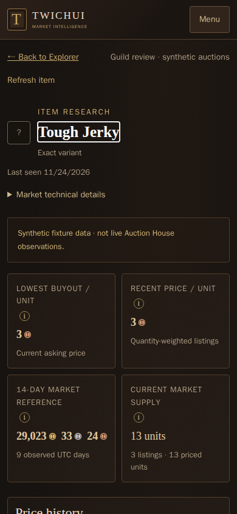
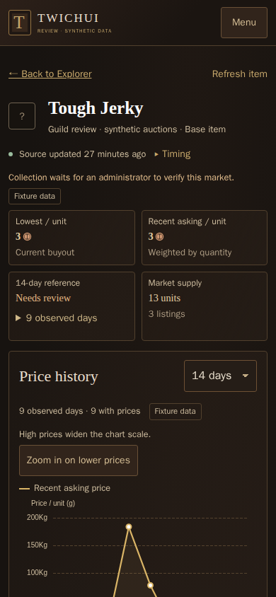
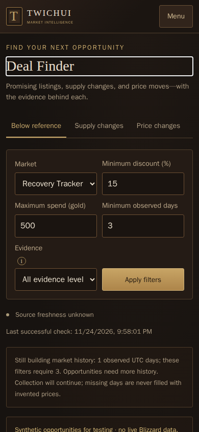
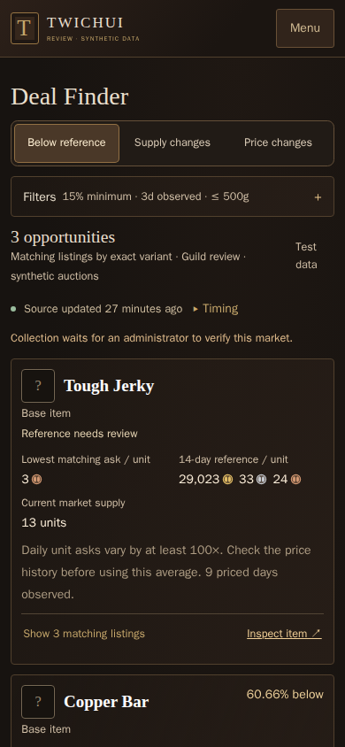
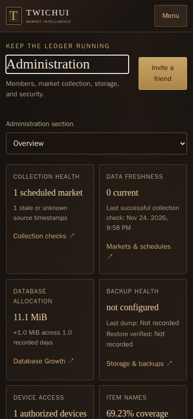
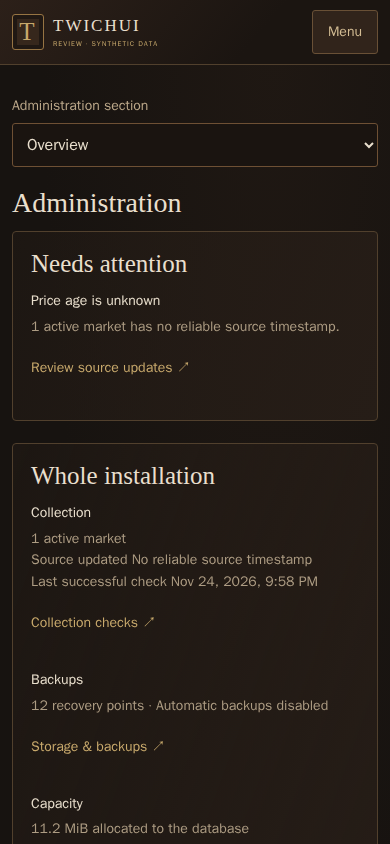
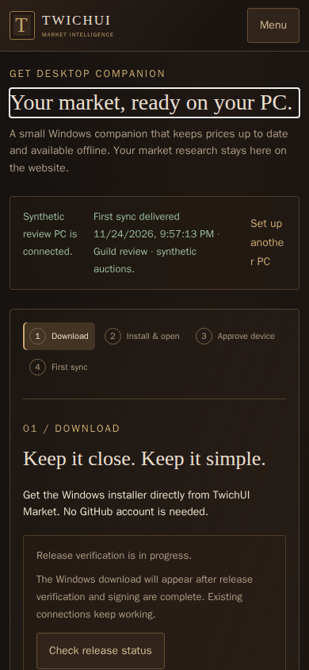
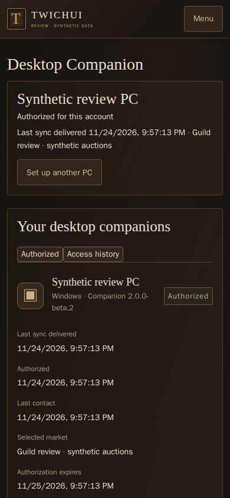

# Market UX review gallery

The phone captures use 390 × 844 CSS pixels unless indicated. The baseline is the merge of Storage & Backups PR #58, `3836c2a`. Both versions ran against isolated test data. The member and admin accounts have different permissions.

| Task | Before | After |
|---|---|---|
| Search and compare exact variants |  |  |
| Read an item's current price and history |  |  |
| Find an opportunity |  |  |
| Investigate installation health |  |  |
| Check Companion delivery or add a PC |  |  |

The [desktop comparison](desktop-explorer.png) shows the outer catalogue and exact-variant columns. The [empty search at 375 × 667](after-empty.png) shows its recovery guidance within the first screen. The [questionable reference at 375 pixels](reference-needs-review.png) shows the 3-copper asking price and its evidence link. The [ordinary-member Companion screen](after-beta.png) provides the Windows handoff.

The [UTC calendar](after-calendar.png) shows a mixed day from the running review's simulated backup service. The [WebKit backup dialog](after-webkit-backup-details.png) uses controlled browser fixture records to show the heading, dismissal control and archive safety state. See the [functional acceptance matrix](acceptance.md) and [implementation inventory](../../market-ux-redesign-inventory.md).
