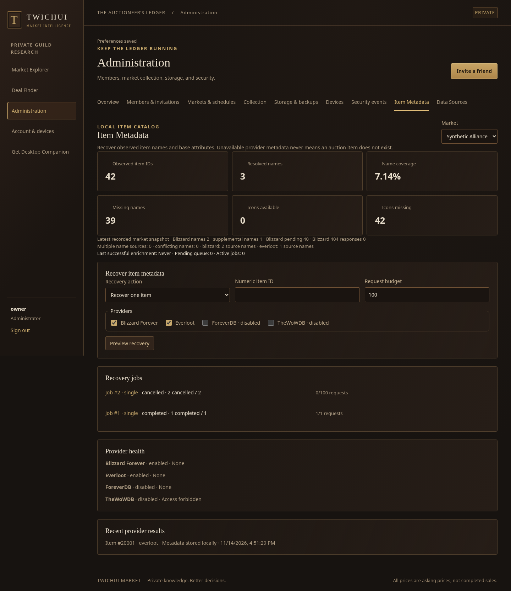
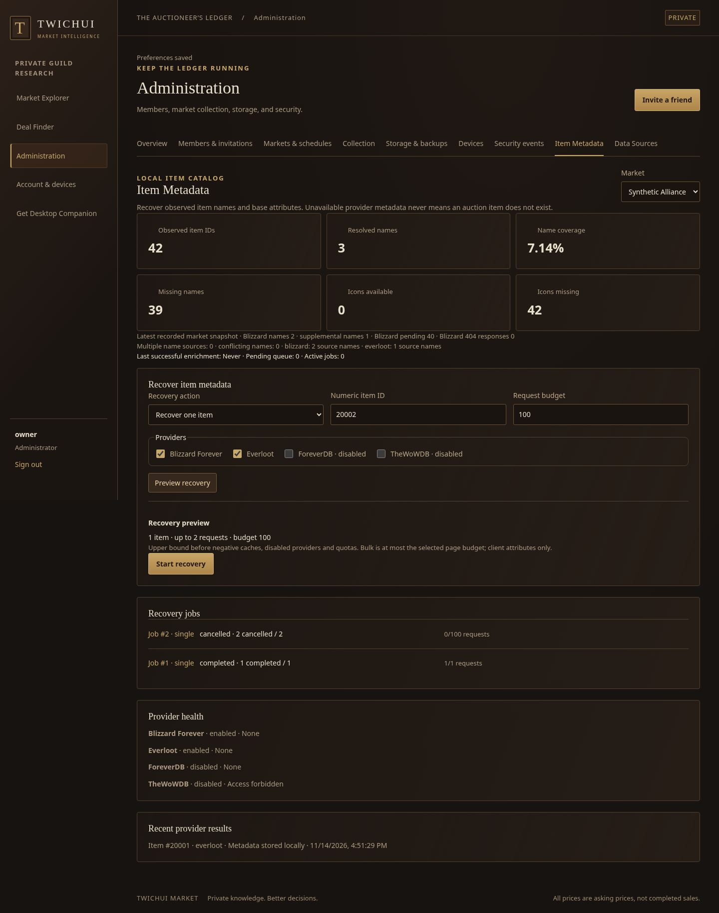
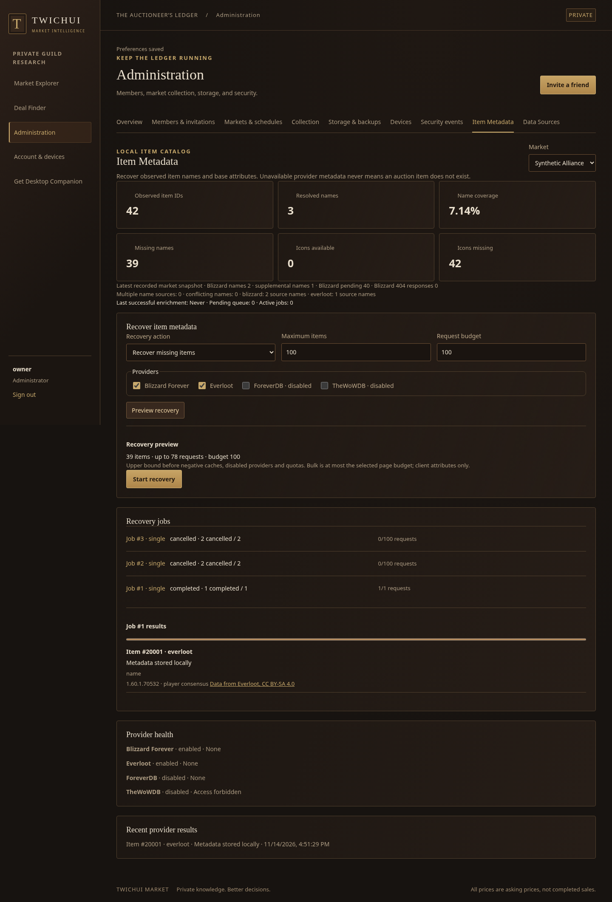
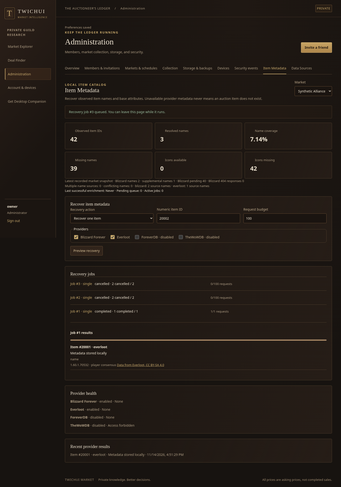
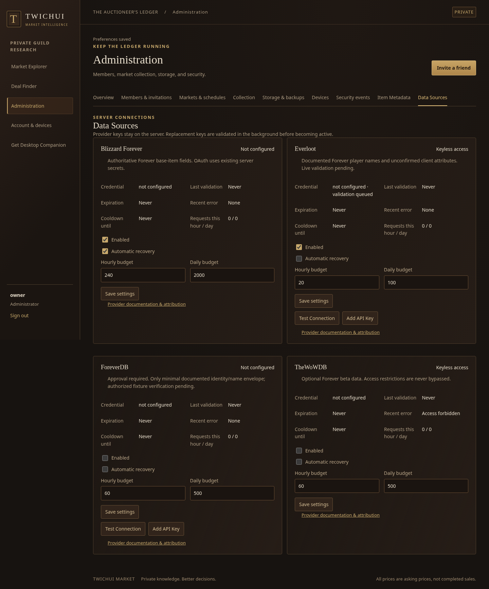
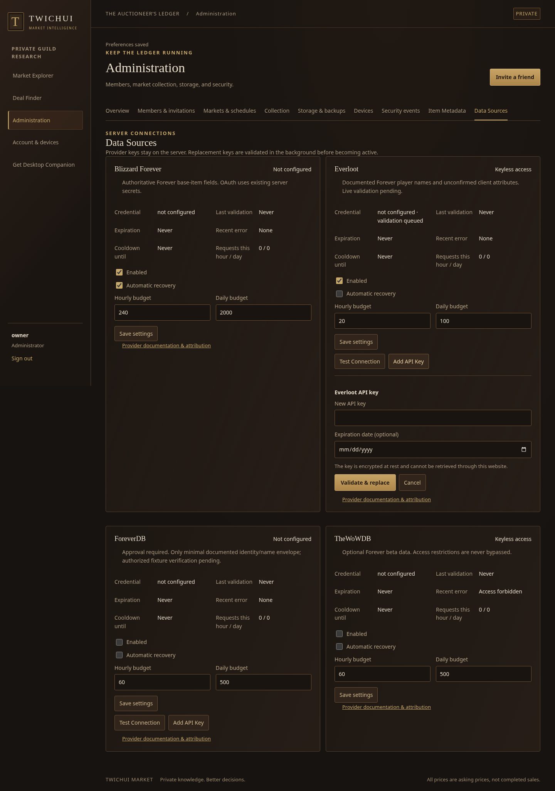
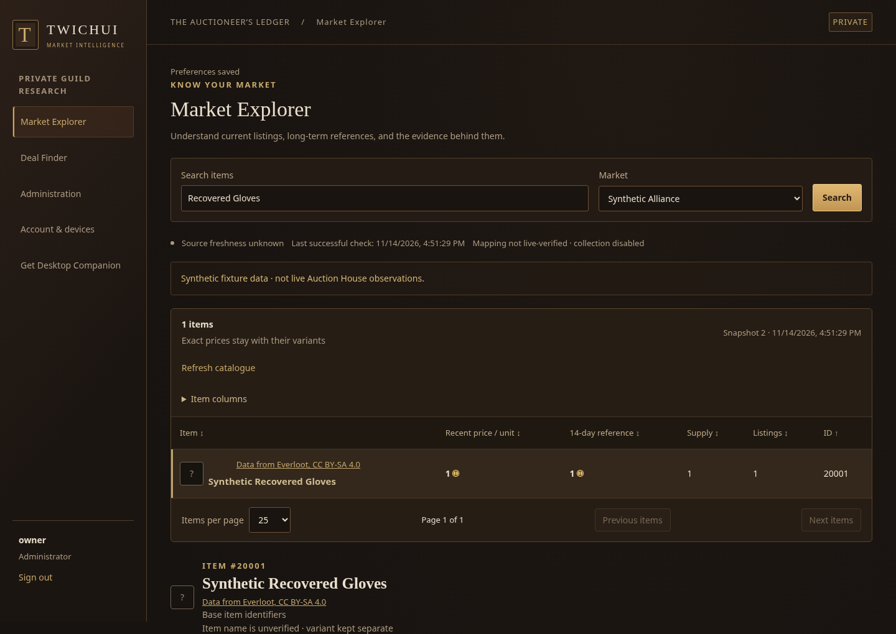
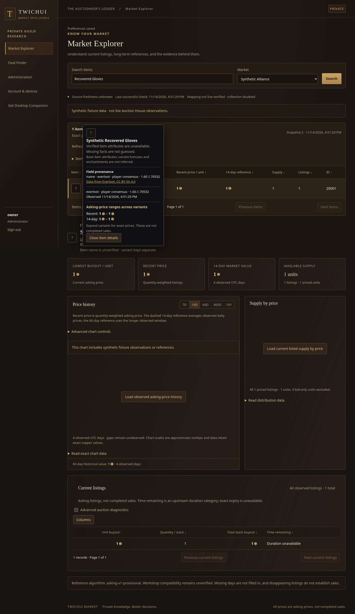
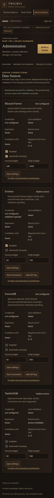

# Metadata recovery visual review candidates

Actual Chromium screenshots, synthetic isolated market_test data. No production coverage or live-provider validation is implied. These candidates have been inspected for readability, alignment and consistency with the existing design; explicit owner visual approval remains pending. The secret form is empty.

## 01 overview

## 02 single item

## 03 batch preview

## 04 progress results

## 05 data sources

## 06 key replacement

## 07 explorer

## 08 tooltip provenance

## 09 mobile sources

