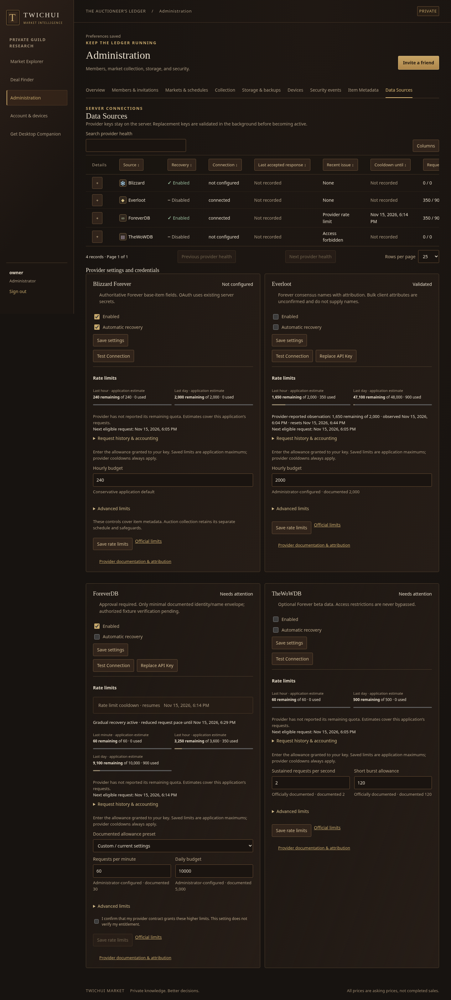
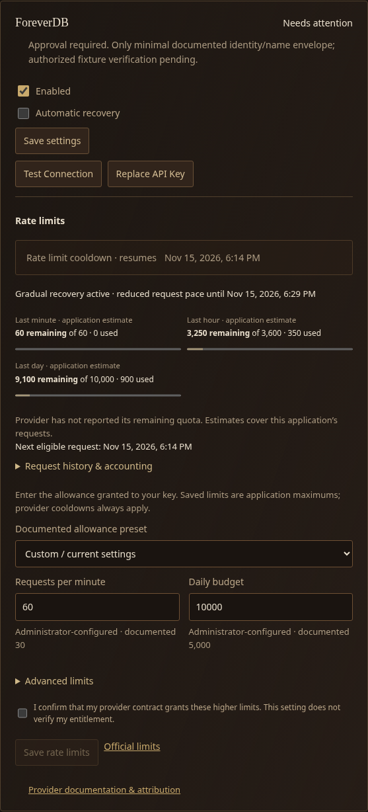
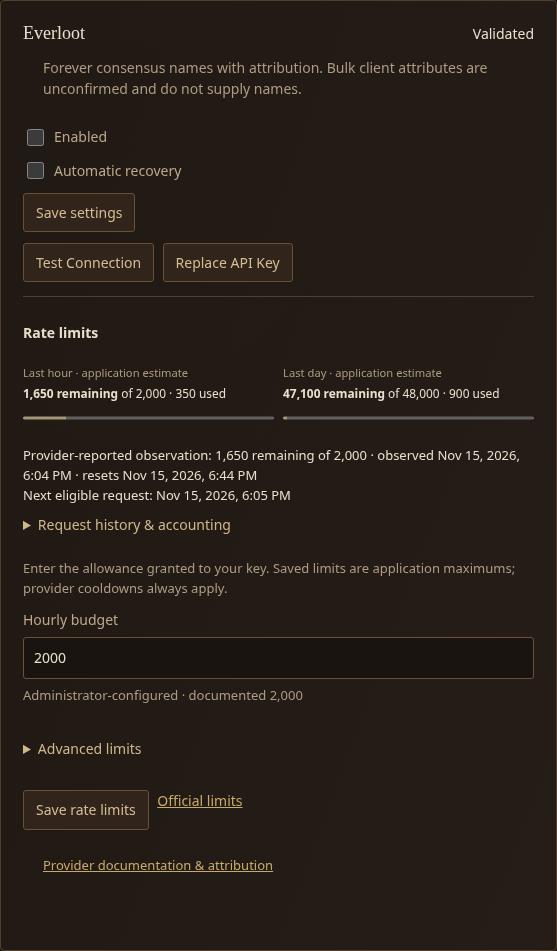
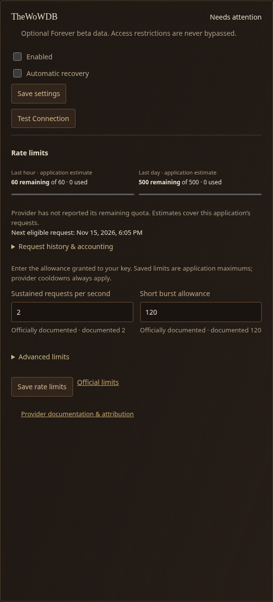
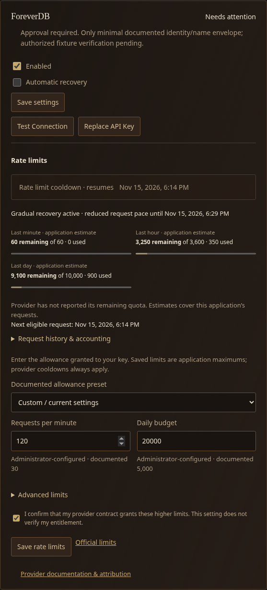
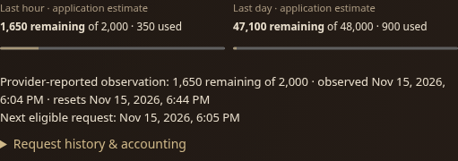
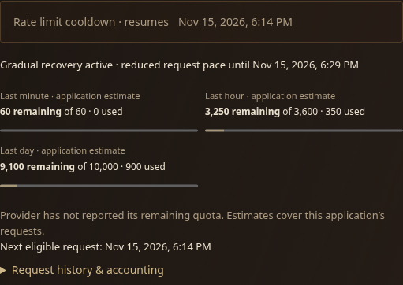
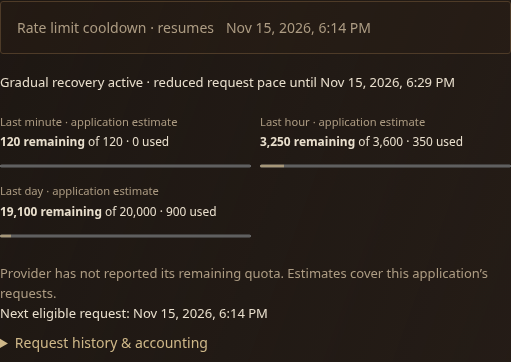
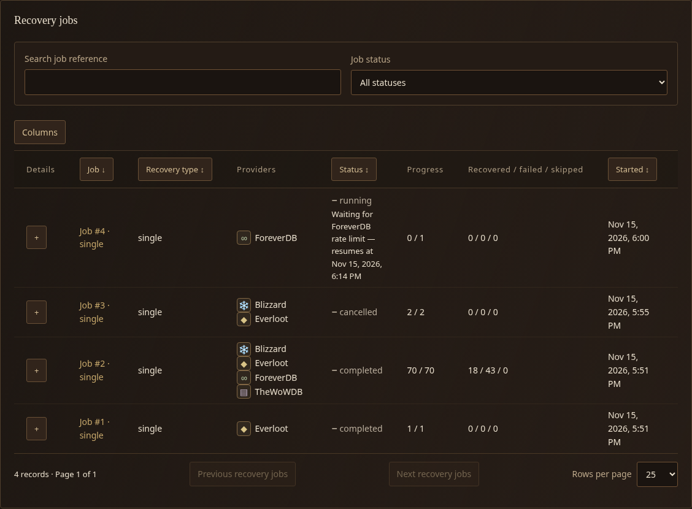
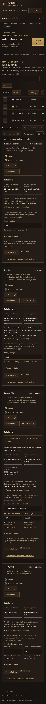

# Provider rate management visual review

Actual Chromium captures from isolated `market_test`, **entirely synthetic quota data and fake encrypted credentials**. No live provider calls or production observations. Browser timezone: America/Denver. This is a review candidate, not design or deployment approval.

[Standalone gallery](review.html). Each image opens at its original size.

## 1. Data Sources overview

## 2. ForeverDB configured limits

## 3. Everloot configured limits

## 4. TheWoWDB refill and burst

## 5. Editing an approved custom allowance

## 6. Synthetic provider-reported remaining quota

## 7. Application-estimated remaining quota

## 8. Persistent HTTP 429 cooldown after saving

## 9. Recovery job waiting for quota

## 10. Narrow administration at 390 pixels

