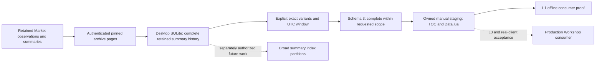

# L2 — scalable history archive and bounded WoW delivery

Status: implemented on isolated `feature/scoped-market-delivery-l2`, published as **[draft Market PR #15](https://github.com/Twich-Team/TwichUI-Market/pull/15)**. Stop before merge, deployment, L3 runtime integration, real-game installation or M2 automation. Production history/counts and Forever responsiveness remain open acceptance gates.

## Executive summary

The companion can now synchronize a complete authorized **retained summary-history layer**, resume interrupted downloads, validate and promote a transactional SQLite archive, and manually export an exact selected history as approved bridge schema 3. The archive is independent of both the legacy scalar cache and the WoW working set. Scope changes never delete archived history. Failed or over-budget candidates preserve completed data and artifacts.

The 45,125-variant synthetic acceptance transferred 90,249 snapshot-summary records across two source observations, interrupted/resumed, then incrementally applied another 45,124 records. Initial SQLite allocation was 167,731,200 bytes; sampled native RSS stayed around 15.7 MB while downloading. A 100-variant selected artifact was 141,703 canonical bytes / 191,202 Lua bytes. This demonstrates separation of archival scale from client payload size. It is not genuine production or Forever frame-time evidence.

Universal Item Advisor remains a separate coverage goal. A detailed set of 100 exact variants does not define the Advisor's candidate universe. The experimental broad-summary interface can represent every recognized exact variant independently of detailed-history membership, but its 45,125-row all-priced prototype still required 5.78 MB source / 31.37 MB retained offline heap. Whole-index compilation took 238 ms in one offline sample. Evaluate bounded, independently validated summary partitions in L3/L4; do not ship a new full-market Lua addon by assumption.

## Integration ledger and authoritative inputs

| Checkpoint | Exact revision |
|---|---|
| Market initially inspected | `73617a9e2ce6b32f539700c72caab4592a443a2f` |
| Addon initially inspected | `732ccf87b825c7f93d7dbb73cae9fa9bfb001fd8` |
| Approved research [Market #12](https://github.com/Twich-Team/TwichUI-Market/pull/12), merged first | `b94acea3cf8210083e091fcc058e9e27b6fea73c` |
| Approved contract [Market #13](https://github.com/Twich-Team/TwichUI-Market/pull/13), merged second; L2 initial base | `3643fb619f57373504ed50578bbdb3566780e180` |
| Approved consumer proof [TwichUI #24](https://github.com/Twich-Team/TwichUI/pull/24), merged third | `5133a43477237bf7cd97a429a680a751a9533f7c` |
| Later integrated Market development base, preserved | `6bb71a61fa3493da3f418288c3af1841fabfb0fc` |
| Isolated L2 merge preserving those upstream changes | `b4ea388ffd3ef89ef81c0c29cf97eb2bdd6d8c80` |
| Frozen L2 runtime / representative capacity source | `2487360bb004e28ad14b6987ffbd8604c3495118` |

#12's head was reconciled with then-current development at `7825059f364946e40fd5da02ff62ee788ca07eb7`; all four checks passed before merge. #13 was reconciled with merged #12 at `aa2321ef6048ad3f0552c06b051bfa6d30696a82`; all four checks passed. #24 had no configured CI checks; its four scoped and six legacy affected proofs passed locally before merge. Drafts were marked ready only for these owner-authorized L1 merges, using expected-head checks and normal merge operations. No protection bypass or force push occurred. #15 remains draft and unmerged.

Read inputs: [source architecture](architecture.md), [pricing specification and recorded M0 decisions](unified-pricing-m05.md), [M1a canonical implementation](unified-pricing-m1a.md), [bridge-v1 contract/amendment](../contracts/bridge/v1/AMENDMENT-001.md), [M1b acceptance](workshop-bridge-m1b.md), [M1.5 performance/capacity](workshop-bridge-m15.md), [large-market research](workshop-bridge-large-market-investigation.md), [L1 specification/roadmap](workshop-scoped-bridge-l1.md), actual server derivations/export, Rust cache/publisher, and addon Bridge/BridgeValidate/ServerMarket/Advisor/Sell/AdvisorData modules. Actual paths and implementation govern where older proposed endpoint names differed. As recorded in the approved research, the original M0 originating chat is unavailable; its recorded decisions are recoverable from M0.5 and source, rather than an invented standalone M0 document.

The canonical 15-payload L1 bundle and addon mirror remain byte-identical, including original v1 dependencies. Manifest SHA-256 is **`c5a465e323005735444f3e5fe2ec48241f50942ebdfb7e7078049849206ec2a7`**. Addon `UPSTREAM.json` correctly pins authoritative fixture commit **`74686fefacb5e43d6ad9d02c827a859859d09082`**, retained in merged #13's ancestry. A merge commit need not replace that unchanged byte-provenance pin. No production addon files changed in L2; no secondary PR is necessary.

The integrated ForeverDB/provider/Explorer/deployment changes are preserved unchanged. The archive migration descends from `fdb_20261116`; it does not alter that migration. Existing nonempty migration probes now assert retention of their **actual upgraded head** on refused downgrade, like the existing companion probe, rather than hard-coding an older head. Their row/credential/counter/queue and refusal checks remain intact. No metadata client, quota, scheduler, administration, Explorer or deployment behavior was changed.

## Architecture and scope



The new [archive protocol specification](../contracts/archive/v1/README.md) documents closed wire schemas, hashes, authentication, consistency, resource bounds, storage and recovery. It is separate from bridge contract 1 / transport 1 / schema 3. Legacy schemas 1/2 and the original 64 MiB pre-compaction server-build, 32 MiB canonical and 130 MiB Lua constraints are unchanged.

“Complete archive” means every observation and unique summary snapshot **currently retained by the server at the pinned watermark**, for the chosen supported algorithm. It excludes raw listing/distribution copies and metadata-provider payloads. It does not claim observations that were never collected, or canonical prices that cannot be recovered from retained originals/derivations. Raw historical listings can remain server-side. Neither disk representation nor a network archive is a Lua addon or Lua heap.

The archive preserves intraday and historical-only identities, missing dates, current revisions, source completeness, exact copper and algorithm/history-basis provenance. WoW generation selects every eligible daily close in the requested supported window and retains supporting references for existing 14/60-day calculations. Current-day provisional status follows the existing as-of-day rules; no new contract enum or fabricated final close was introduced. Selected history is bounded to the latest 60 UTC days under the approved contract; older retained evidence remains archived. Unsupported windows refuse, never silently shorten.

## Producer, authentication and checkpoint consistency

`GET /api/v1/archive/markets/{id}/checkpoint` creates/reuses a fully pinned source header after bounded cold preparation. `GET .../pages` streams ordered observations, snapshot descriptors and exact-variant summaries. `POST .../scoped` consumes the **unchanged L1 selection schema** and produces a source-sealed schema-3 generation. The L1 proposed `/bridge/scoped/selections` route was a roadmap example, not an implemented frozen endpoint; this distinct archive route binds the actual checkpoint directly.

Existing member/device authorization and verified market selection apply. Cursors are HMAC-sealed and bind account/device, market, checkpoint, protocol/domain, keyset, offset, chain and expiry; source algorithm/query are immutable checkpoint properties. Device identity survives access-token renewal; revoked/wrong-device/wrong-account requests refuse. Bootstrap selection is checked against authenticated account/source identity before native archival. No credentials enter exported bytes and no route triggers provider collection.

The checkpoint's observation-ID watermark and frozen metadata resist new arrivals and late imports during a transfer. Keyset queries avoid deep offsets; batches reuse existing set-based derivations and record readers. One cold snapshot/digest is prepared per HTTP 202 step. Header metadata seals every observation and snapshot digest; pages have per-page and rolling hashes; final validation checks counts, exact transfer bytes, metadata root, retained date bounds, observation-to-snapshot content hashes and transferred record digests. Every snapshot is archived once per source/algorithm, even when many observations reference it. No complete market-generation JSON/Lua intermediate exists.

Initial archive service guards are 100,000 observations, 4,096 unique snapshots and 100 million normalized summary entries, plus 64 MiB metadata per checkpoint / 256 MiB aggregate disposable metadata / 512 checkpoints. Pages have at most 100 entries / 1 MiB, and entries 64 KiB. These are service refusal bounds, not measured capacities or changes to WoW protocol limits. SQL uses the existing retention/ingestion advisory lock and 10-second per-statement deadline. Maximum-shape whole-request CPU time is not established; the measured 45,125 shape fits the native request timeout, but real cold history still needs acceptance.

Checkpoint pages expire after 24 hours; offline completed data does not. Base metadata normally survives seven days. Equivalent requests reuse checkpoints; pressure reclaims expired metadata and refuses new requests rather than evicting unexpired peer downloads. Missing/expired/inconsistent bases cause bounded staged-state reset and full bootstrap. Source retention changes cannot silently reuse a stale whole-source membership list.

## Transactional desktop archive and incremental synchronization

A separate `history-archive-v1.sqlite`, schema `user_version=1`, leaves existing scalar and bridge-v1 databases intact. Origin/account/market/algorithm scope keys isolate data. `history_headers` stores staging, active and previous pointers, cursor/offset/chain and completion time. `history_entries` holds immutable normalized evidence with checksums; `history_stage` isolates pending rows; `history_members` binds each complete checkpoint's observations/snapshots; `history_selections` persists private exact requests. Indexed identity/time/day access supports selected projection without loading the whole database into JSON.

Each page and its committed cursor advance in one transaction. Final hash/graph/count validation precedes set-based promotion of rows and pointers. Process interruption, replay, malformed order, mixed checkpoint, corrupt evidence, storage failure and capacity refusal preserve completed state. SQLite FULL/WAL transactions and a real `SQLITE_FULL` fault test prove rollback of cursor updates; newer schema and corrupt database files fail closed without reinitialization. Physical drive loss still requires backup/rebootstrap; no claim of immunity to physical corruption is made.

Incremental checkpoints transfer new observation IDs and newly referenced snapshot evidence. Repeated snapshots transfer only observation metadata. A revised provisional day creates a new immutable observation/snapshot; close selection recalculates from the pinned source. Late-imported old UTC dates are handled by their new IDs. The completed archive retains old rows even after a full bootstrap reflects later server retention. The new checkpoint's membership prevents old retained rows from filling its gaps or proving absence. Previous completed pointers remain separately available; there is no automatic history pruning or cache-deletion upgrade requirement.

Default archive budget is 4 GiB, manually adjustable from 64 MiB through 64 GiB. Transfer estimates are advisory; SQLite index/page/freelist allocation is not predicted exactly. Actual allocated pages/WAL, 16 MiB free-disk reserve and SQLite page limits are checked during staging and before promotion. A storage refusal reports the bound and preserves prior data; raising a budget can resume pending state. Complete local retention can eventually exhaust any chosen budget. Genuine retained density must determine an appropriate disk policy before rollout; no linear production-capacity promise is inferred from the two-snapshot fixture.

## Exact scoped delivery, absence and publication

Selections bind issuer/full market, supported algorithm/basis/profile, sorted `(item_id, full variant_key)` identities and exact UTC window. Duplicate identities refuse. An exact server variant never becomes an aggregate local item-ID price. Unknown exact identity, wrong market/account, unsupported schema/algorithm/window or integrity mismatch refuses the whole request. A known historical-only descriptor can be resolved outside the currently projected 60-day support range without inventing observations.

| State | Meaning and behavior |
|---|---|
| Included, priced | Exact supported asking-price observations, with provenance |
| Included, supply-only | Supply is known; absent price remains null |
| Included, confirmed absent | Selected identity not listed in a **complete** source observation; no zero price |
| Included, incomplete/unknown | Unknown current state and/or `incomplete_only` calendar coverage; no inferred absence |
| No source observation date | `no_observation`, no fabricated daily row or interpolation |
| Outside requested selection | `outside_scope`; not whole-market absence or unsupported-provider evidence |
| Requested invalid/unavailable exact identity | Request-level refusal; no partially fulfilled generation |
| Unsupported arithmetic | Explicit unsupported valuation, with exact archival strings retained |
| Budget/authorization/version failure | Whole-candidate refusal; previous completed generation retained |

For a successful selection, `scope_complete=true`, `whole_market_complete=false`, and legacy `coverage.generation_complete=false`. Every requested identity appears, `excluded=[]`, and all eligible requested closes are present. Content changes, dates, watermark or algorithm produce the appropriate request/generation identity changes; unchanged same-day source checks preserve recovery slots. Desktop completion receipts remain outside source hashes, are minted after validation and cannot predate their generation.

Default policy is **100 exact variants, 2 MiB canonical and 3 MiB Lua**, with exact final sizes checked. This is a testing/delivery policy, not a proven Forever comfort bound. The distinct schema-3 protocol ceilings remain 1,000 requested records, 256 KiB manifest, 32 MiB canonical / 130 MiB Lua. Early count preflight and exact byte checks never prune identities, shorten history or substitute an alternate profile. A 200-item dense proof explicitly raises only its **test count policy** to 1,000 so byte refusal can be tested independently.

Manual companion controls download/resume, persist exact selection text, show market/checkpoint/window/count/sizes/generation and preview/export. Updated data is written only to owned companion `workshop-testing` staging: fixed `TwichUI_MarketData.toc` and assignment-only `Data.lua`, no SavedVariables declaration, `loadstring`, arbitrary code/destination, addon installation or reload. Existing escaping, ownership/ACL/link/junction/reparse checks, temporary files, flush/sync, readback, atomic replacement and last-good artifact protections are reused. Corrupt/unowned existing artifacts refuse replacement. `Previous.lua` remains a recovery file, not an automatically loaded TOC entry.

Current Workshop has **no schema-3 production reader**. The panel states that limitation and requires testing acknowledgement. It never claims WoW loaded its staged files. The in-game selection/request handoff and installation/update/reload workflow remain later milestones; users can presently request additional exact histories through manual companion selection without manually exporting source history files.

## Compatibility matrix

| Combination / event | Behavior |
|---|---|
| Old desktop + old addon | Existing schemas 1/2 path unchanged |
| New desktop + old/current addon | Legacy manual export remains available; schema 3 is testing-only and old runtime refuses it |
| Old desktop + merged addon #24 | Existing production reader remains 1/2; L1 test files do not activate schema 3 |
| New desktop + L1 test consumer | Scoped artifacts validated offline; actual production L3 reader remains pending |
| New desktop + old server | New archive route is unavailable/refused; legacy route remains explicit, no silent scoped reinterpretation |
| Future archive/schema/required feature | Strict refusal and completed-state retention |
| Interrupted/mixed generation | Persisted cursor/chain, immutable membership and transaction checks prevent promotion |
| Wrong market/account/device | Authenticated source/context refusal; private selections cleared from UI on context change |
| Valid legacy whole-market generation | Existing validator/cache/publisher continue to accept schemas 1/2 |
| Valid scoped generation | Server/Rust/L1 consumer agree; scoped and whole-market completeness remain distinct |
| Corrupt/oversized scoped generation | Refuse before publication, retaining last-good archive/artifact |
| Downgrade | Use a supported complete legacy artifact/app; do not relabel schema 3 or downgrade the independent archive database |

## Quantitative evidence

All new datasets are **synthetic**, generated through actual ingestion or explicit disposable archive fixtures. The production 45,125 figure remains a reported earlier observation; no current genuine count was measured. This is a focused capacity investigation, not another five-pair matrix. Timing is one shared Linux-host/debug-Rust sample per workload, with concurrent test load; it is not a Windows/Forever performance guarantee. Exact bytes/statuses are reproducible; timings vary.

[Fingerprint-backed 45,125 acceptance](evidence/scoped-market-l2/archive-45125.json) records implementation hashes, native binary hash and source revision. Initial shape: 45,125 exact identities / 45,124 item IDs, two observations/snapshots, one historical-only identity, bid-only supply, a same-item different exact variant, two eligible UTC days within a 60-day request and 58 missing dates. Incremental shape adds one new same-day snapshot. No synthetic fixture is presented as genuine retained history.

| Measurement | Frozen representative result |
|---|---:|
| Initial summary entries | 90,249 |
| Initial page count / page bytes | 903 / 31,781,463 |
| Cold preparation + first page / resumed transfer | 25.98 s / 103.77 s |
| Final validation / pointer-and-row promotion | 7.74 s / 3.19 s |
| Complete SQLite allocation | 167,731,200 B (159.96 MiB) |
| Sampled native download peak RSS | 15,671,296 B (14.95 MiB) |
| Incremental entries / page count / page bytes | 45,124 / 452 / 15,890,693 |
| Incremental preparation/first page + resume | 13.20 s + 49.89 s |
| Incremental final validation / promotion | 3.51 s / 1.35 s |
| SQLite after increment | 183,582,720 B (175.08 MiB) |
| Server main SQLite file after acceptance | 224,206,848 B; includes source listings/statistics/derivations, not equivalent to archive or WoW payload |
| Server sampled request RSS / process peak including seed | 136,531,968 / 194,969,600 B |
| Server process request CPU / archive-page CPU | 86.67 s / 47.41 s; includes small same-process coordinator overhead, excludes seed/native child |
| Maximum SQL statements in one page / all page statements | 9 / 6,785 over 1,355 page requests |
| Maximum measured page response wall time | 188 ms |
| 10-variant export: canonical / Lua / manifest | 21,010 / 28,659 / 10,260 B; 213 ms |
| 100-variant export: canonical / Lua / manifest | 141,703 / 191,202 / 34,113 B; 964 ms |
| 200 variants × 60 closes, dedicated byte-refusal proof | 2,537,415 canonical / 3,615,344 Lua / 84,003 manifest B; refused 2 MiB policy |

Initial effective page throughput including cold preparation and validation was roughly 0.23 MiB/s on this debug/loopback pipeline. This is end-to-end processing throughput, not a network bandwidth limit. Real deployment PostgreSQL query plans, network latency, Windows release builds and retained density need measurement. The nine-statement maximum is a phase-boundary case; ordinary pages have a fixed set of bounded queries, not one per variant.

The first 45,125 experiment exposed a SQLite join order that scanned too much evidence per selection; indexed selected-identity-first joins reduced the 100-item export from ~9.5 s to ~0.8 s in the intermediate comparison. Frozen receipt/date validation yielded ~0.96 s. Only those implementation changes justified repeating the representative case; no exhaustive capacity matrix was rerun. [Dense refusal evidence](evidence/scoped-market-l2/dense-refusal.json) uses the actual Rust archive/projector and independently verifies all 60 daily rows before applying the narrower byte policy.

Existing L1 dense-100 sizing (~1.30 MB canonical / 1.84 MB **test-wrapper** Lua) and M1.5 client evidence remain useful context, not new client acceptance. M1.5's dense-1,000 offline validation was about 27.24 seconds CPU; whole 25,000 loading was already unsuitable. Smaller serialization does not eliminate synchronous compilation, assignment, global GC, addon load ordering or startup costs. No safe Forever frame-time bound is claimed by L2.

## Universal Item Advisor compatibility and Tier A feasibility

[Experimental separate interface and limitations](../contracts/market-summary-index-proposal/README.md), [schema](../contracts/market-summary-index-proposal/schema.json), [measurement](evidence/scoped-market-l2/advisor-index.json). It is not advertised by server/desktop/addon and is not a new runtime pricing engine.

The smallest useful broad summary carries item/exact-variant identity, explicit availability state, supported recent/Market Value/minimum references, supply, observation age and source-qualified confidence; shared market/issuer/observation/completeness/watermark/algorithm/basis and hashes qualify the whole part. Copper remains exact text. Vendor values come from existing item evidence, disenchant returns remain uncertain unless verified, and external asks never impersonate local competition. Per-source unavailable/unknown differs from confirmed absence and insufficient evidence for a decision.

The all-priced synthetic capacity shape deliberately uses 45,125 supported variants, three distinct 11-digit copper strings each, supply 12 and age 300 seconds. It does not assume production's unmeasured priced fraction.

| Offline Lua 5.1 feasibility | Whole 45,125 | One of 16 item-ID partitions (2,821 rows) |
|---|---:|---:|
| Canonical rows / Lua assignment source | 5,776,001 / 5,776,029 B | 361,089 / 361,117 B |
| Compilation | 238.09 ms | 7.72 ms |
| Assignment | 42.87 ms | 0.54 ms |
| Minimal structure checks + lookup-index construction | 58.53 ms | 2.81 ms |
| Explicit global GC | 20.34 ms | 0.81 ms |
| Retained heap including compiled chunk and index | 31,371,429 B | 1,960,373 B |
| 10,000 exact-key lookups | 2.26 ms | 0.91 ms |

Full future hash/consumer validation is **not** included in those minimal checks. All 16 loaded partitions eventually retain the complete heap plus overhead. A larger priced/supply shape or more provenance increases bytes; compressed transport does not remove client materialization. The whole proposal exceeds the detailed 3 MiB Lua policy and has substantial synchronous offline costs. Do not raise Lua limits to declare it safe. Start L3 with a separate version/capability and bounded stable item-ID partitions, per-part integrity and explicit loaded/available coverage. Partition skew must refuse or follow a reviewed deterministic split. L4 may require more/smaller parts; 16 is a feasibility example, not an approved addon count.

Current `AdvisorData` discovers bag, tracked, recipe and local identities. `Advisor.Decide` preserves crafting reservations/pending plans, auction eligibility, explicit variant uncertainty, vendor 1.5×/gain thresholds and verified disenchant comparisons. `Sell.Suggest` and `Sell.Observation` require local competition/distribution/freshness/quality evidence. Imported summaries are separately marked `market_server_asking_summary`, confidence ceiling `limited`, `can_satisfy_local_competition=false`; they cannot satisfy those predicates. Equipment/keep rules, local calculations/scans and missing metadata stay unchanged. No Advisor runtime code changed.

Exact server hashes cannot simply be inferred from every WoW item link. Future resolution must prove the supported exact variant or expose unsupported/insufficient evidence; item-ID aggregates remain distinct. An unknown newly received item can still be considered for Vendor/Keep/Disenchant from legitimate local evidence while Auction remains unavailable. A later exact-history request must travel through a persisted companion workflow, not arbitrary WoW HTTP. Broad price availability and detailed history membership remain independent.

## Verification and known corrections

- **89 Rust checks pass**, one existing opt-in profiler intentionally ignored. Includes legacy caches/bridge/publisher, new transactional archive, crash/resume, duplicate/order/context/hash/version controls, real SQLite-full rollback, corruption/newer-schema refusal, source-retention membership, incomplete-source unknown states and dense exact-byte refusal.
- **Nine final archive tests pass on PostgreSQL and SQLite**, including real companion token rotation, device mismatch/revocation, immutable pages during new arrivals, reused snapshots, historical-only/bid/large-copper evidence, retention changes, schema validation and scoped server generation/refusal.
- **16 L1 Python conformance tests and four pinned addon Lua proofs pass**. All 15 mirrored payloads plus manifest remain exact; unknown schema and legacy refusal remain intact.
- **43 operational Python checks pass**, including proposal unknown/missing/not-zero/independent-coverage/provenance controls and refusal of non-test database migration invocations.
- Nonempty PostgreSQL rehearsals pass for archive, existing metadata, provider rates, ForeverDB and companion migrations. New archive downgrade removes only its disposable checkpoint/digest tables, preserving all 35 existing tables and seeded history/preferences. Source data and installed old caches are retained.
- Actual authenticated HTTP → Rust archive → independent server/Rust scoped byte equality → safe publisher → L1 Lua artifact proof passes at 129 and 45,125 variants, including interruption/resume, incremental updates, exact `100/120→100/140` closes, canonical lower weighted median `100`, absent historical-only current state, bid supply `2`, 58 missing days and excluded same-item variant. Explicit provisional mode separately proves `110→120` daily-reference means without silently changing algorithms.
- Mocked-IPC browser checks pass explicit sync/selection/preview/export acknowledgement, capacity refusal, account-change clearing, compact layout and accessibility. Actual Windows CI separately exercises the installed WebView/Rust command, authenticated archive, SQLite, staged schema-3 publication and uninstall retention. Mocked UI screenshots are not native evidence.

Initial CI also correctly refused the Python fixture's ambiguous Windows temporary staging ACL. Only that newly created disposable fixture directory now receives a private user/System/Administrators ACL; production guards remain strict, including broad-write/junction negative tests.

Initial CI found two migration heads after concurrent metadata integration and an ambiguous `.more summary` selector caused by the new panel. The archive now descends from the new metadata head; its uniquely classified panel preserves both legacy More/Advanced selectors, with explicit browser regression checks. Successful archive actions clear prior transient UI errors while retaining native connection errors. Initial full local PostgreSQL execution passed 583 cases and failed one new retention fixture because its synthetic deletion omitted an existing daily-observation FK; that fixture was corrected and all nine archive tests pass on PostgreSQL. No assertions were removed to hide a failure. The affected existing UI assertion now explicitly checks the fixed sync-interval select and the bounded, collapsed archive-budget field.

At `59699fe8a99f4806604f9e510ad0a06aaea2eeca`, PostgreSQL CI passed all **584 backend tests**, five nonempty migration rehearsals, 43 operational tests and 16 L1 tests. Website CI passed the build/audit, **123 unit tests**, 41 ordinary browser workflows plus one ForeverDB and one provider workflow, and focused archive UI/accessibility. Native Windows core/Tauri compilation and both archive pipeline modes passed; the final installed-UI selector correction is verified by the final PR checks. Exact-source outcomes and links are published with PR #15's checks and the accompanying evidence ledger. No unrelated two-hour addon simulator or five-pair performance campaign was run. No production credential/history access, external provider quota, live collection, deployment, real game files or SavedVariables were used.

## Reproduction

Use Rust 1.100, Python 3.12 with `backend/requirements.lock`, pinned frontend packages and Lua 5.1 plus `bit` for the existing offline proof. Tests requiring sockets need an environment that permits disposable loopback listeners. Run destructive PostgreSQL tests/rehearsals **serially**, only against a newly created `market_test` database; never production. Set an explicit source contract path if running outside a checkout.

```sh
cargo test --manifest-path desktop/Cargo.toml --workspace --locked
cargo build --manifest-path desktop/Cargo.toml --example archive_smoke --locked
# From backend/, with DATABASE_URL pointing only to disposable market_test:
python -m pytest -q
python ../scripts/verify-archive-migration.py
python -m unittest discover -s ../contracts/bridge/scoped-l1 -v
# From repository root; choose the platform's .exe suffix on Windows:
python scripts/verify-archive-e2e.py --rust-client desktop/target/debug/examples/archive_smoke --addon-root /path/to/TwichUI --report /tmp/archive-small.json
python scripts/verify-archive-e2e.py --rust-client desktop/target/debug/examples/archive_smoke --addon-root /path/to/TwichUI --variants 45125 --report /tmp/archive-45125.json
python scripts/verify-archive-e2e.py --rust-client desktop/target/debug/examples/archive_smoke --addon-root /path/to/TwichUI --algorithm asking-v1-provisional --report /tmp/archive-provisional.json
cargo test --manifest-path desktop/Cargo.toml --test archive dense_history -- --nocapture
python scripts/advisor_index_feasibility.py --report /tmp/advisor-index.json
PYTHONPATH=backend python -m unittest discover -s scripts/tests -v
node web/e2e/companion-archive.cjs
```

`--skip-lua` is an explicit CI-only option when the independent addon checkout/Lua runtime is unavailable; the report says **NOT RUN**. It does not count as the full Lua gate. Local acceptance used the pinned merged addon and actual Lua artifact validation. No source data addon is installed by any command. The 45,125 script fingerprints measured implementation files and native binary to reject changes during a run.

## Genuine-history acceptance procedure — open

No approved production database connection was available. The earlier ~45,125 union is not re-certified as current, and synthetic distributions are not genuine evidence. Do not deploy L2 just to close this gate.

1. An authorized operator obtains safe aggregates in a read-only consistent transaction: market/full mapping identity; retained observation count and UTC min/max; unique snapshots; distinct `(item_id,variant_key)` union from retained statistics/derivations; canonical-original/derivation availability; daily-close/gap counts; historical-only and bid-only counts. Avoid full payloads, secrets and provider calls.
2. Use an already approved encrypted backup/read-only source copy restored into isolated nonproduction infrastructure. Disable all collectors/provider workers, replace authentication with disposable test identities and label source versus transport issuer honestly. Do not modify production databases. New checkpoint creation itself writes disposable metadata, so it must not be run against a read-only production database under this milestone.
3. Independently sample exact priced, historical-only, bid-only, absent and gapped identities from that restored retained source. Pin expected source timestamps/hashes/copper/date membership before invoking L2. Confirm actual retained row volume/disk budget rather than assuming the synthetic shape.
4. Run checkpoint bootstrap, interrupt/restart, resume, verify total/unique counts and hashes; insert a **nonproduction synthetic control** only in a separate clone if testing new-arrival isolation, keeping genuine and control evidence distinct. Verify incremental late-date and provisional updates in a separate disposable fixture.
5. Export 10 and 100 genuine exact histories inside the supported window; compare every eligible close and provenance against independent source queries and both server/Rust generation identities. Verify older local evidence retention on source-retention changes in a disposable clone. Record actual sizes, query plans, duration, memory and refusal diagnostics. Keep payloads/private identities out of repository fixtures.
6. L4 then uses explicitly authorized Windows staging and a separate real Forever installation acceptance. No actual game installation, SavedVariables or reload was touched in L2.

## Follow-up execution order and owner decisions

**L3 — production consumer and broad-summary design.** First implement explicit capability negotiation for schema 3 while retaining legacy 1/2, incremental strict validation, scoped unavailable/absent/gap presentation and source-aware history. Preserve local scans/calculations and source defaults. Test with the authoritative pinned bundle and actual L2 artifacts, including partial/corrupt/mixed generations and prior-state recovery. Separately review the experimental Tier A format/partition integrity and exact WoW identity resolver; broad summary coverage must never depend on detailed membership. No imported external asks may satisfy existing local competition rules. Performance gates include per-slice validation, source retention and memory caps, plus compile/assignment uncertainty carried to L4. Rollback restores a complete supported previous artifact/reader.

**L4 — real Windows/Forever acceptance.** Use genuine retained observations with independently checked expected values. Measure Windows publisher/AV/file-lock/power-interruption recovery, actual addon discovery/load order, compile/assignment stalls, global GC, retained heap, UI frame-time percentiles/worst slice, history correctness and unchanged real SavedVariables. Begin with 10 then candidate 100 sparse/dense histories; reduce policy on failure rather than pruning history. Test real summary partitions separately before approving broad-index runtime budgets. Existing offline timing and CI companion installation do not close this gate.

**M2 — separately authorize delivery automation after L3/L4.** Persist/coalesce working-set intents safely, read only a reviewed explicit addon-request mechanism, retain full desktop history, update staged artifacts transactionally, validate installation paths/ownership and source freshness, and offer player-confirmed reload only. No surprise reloads. Data staged while WoW runs remains pending until a supported future login/reload boundary; loaded addon files are not dynamically reread. A coalesced ordinary update can require zero extra reloads before login or one player-chosen reload during a session; additional requested histories can wait for the next coalesced generation. This is proposed UX, not L2 automation.

Owner decisions remaining: approve L3's separate broad-summary version/identity/partition model; choose the real Windows/Forever minimum acceptance profile and frame/memory budgets; choose archival disk/retention policy from genuine retained composition; and authorize genuine-history staging plus later L3/L4/M2 work. The candidate 100/2 MiB/3 MiB policy is not an owner-independent declaration of game safety.

Rollback of this unmerged candidate is to keep the existing app/API and legacy bridge. If later deployed under separate approval, disable new manual archive entry points/use the supported previous app/artifact; retain original source history and existing scalar/bridge databases. Archive schema downgrade removes only disposable server checkpoint/digest state, never source observations. Never relabel scoped data as whole market, silently prune history, force database downgrade or automatically install/reload anything.
